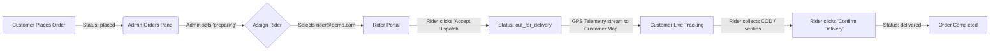

# 🍽️ Baroda Gourmet — Online Food Ordering & Fleet Delivery Platform

A full-stack, enterprise-grade gourmet food ordering and real-time fleet delivery application built for restaurant operations across Vadodara.

- **Live Production URL**: [https://mern-food-delivery-navy.vercel.app](https://mern-food-delivery-navy.vercel.app)
- **Local Dev URLs**: [http://localhost:5173](http://localhost:5173) (Client) & [http://localhost:5000](http://localhost:5000) (Backend API)
- **GitHub Repository**: [https://github.com/arhamshah27/mern-food-delivery](https://github.com/arhamshah27/mern-food-delivery)

---

## 👥 Seeded Demo Credentials

All test accounts are pre-configured in the database:

| Role | Email | Password | Allowed Portals | Description |
|---|---|---|---|---|
| **Admin** | `owner@demo.com` | `Demo@1234` | Full Admin (`/admin`), Menu, Orders, Fleet, Settings | Full administrative restaurant control |
| **Admin (Alternative)** | `manager@demo.com` | `Demo@1234` | Full Admin (`/admin`), Orders, Menu, Rider Approvals | Operations administrator |
| **Admin (Super)** | `admin@barodagourmet.com` | `Admin@123` | Full Admin (`/admin`) | Legacy fallback admin |
| **Delivery Rider (Active)** | `rider@demo.com` | `Demo@1234` | Rider Mobile Portal (`/delivery`), GPS Tracker | Active & approved delivery partner |
| **Delivery Rider (Pending)** | `rider2@demo.com` | `Demo@1234` | Application Under Review (`/delivery/pending`) | Demonstrates pending verification gate |
| **Customer** | `customer@demo.com` | `Demo@1234` | Web Shop (`/`, `/menu`, `/cart`, `/my-orders`) | Regular customer account with address history |

> **Role Model**: The system operates strictly with **3 roles**: `customer`, `admin`, and `delivery_partner` (displayed as "Delivery Rider").

---

## 🔄 End-to-End Operational Workflows



---

### 1. Customer Ordering Workflow

1. **Browse Food Catalogue (`/` or `/menu`)**:
   - Filter dishes by category (*Starters, Main Course, Biryani, Artisanal Breads, Desserts*).
   - Use the **Veg / Non-Veg** diet toggle to immediately isolate dietary choices.
   - Search by name, cuisine keywords, or spice level.
2. **Customizing Dish & Add-Ons (`/food/:id`)**:
   - Choose portion quantity.
   - Select optional add-ons (*Extra Desi Ghee, Mint Chutney, Roasted Papad, Boondi Raita*). Total price updates dynamically.
   - Click **Add to Cart** (adds to cart with instant visual checkmark feedback without interrupting your shopping flow).
3. **Cart & Promo Code (`/cart`)**:
   - Review selected items, item notes, and quantities.
   - Enter promo coupons (e.g., `WELCOME50` or `FLAT100`).
   - Server-side pricing engine (`services/pricing.js`) recalculates item subtotal, discounts, packaging fees, delivery charges, and GST.
4. **Checkout & Payment (`/checkout`)**:
   - Select or add a delivery address with street, landmark, area, and pincode.
   - Select payment method:
     - **Cash on Delivery (COD)**: Placed immediately with payment status `pending`.
     - **Online Payment (Razorpay)**: Opens Razorpay checkout modal with test payment options (Cards, Netbanking, UPI with `success@razorpay`). Automatically verifies cryptographic HMAC signature on callback.
5. **Real-Time Live Order Tracking (`/orders/:id` and `/my-orders`)**:
   - Interactive **OpenStreetMap + Leaflet** map showing:
     - 🏪 Restaurant kitchen location pin
     - 🏠 Customer drop-off location pin
     - 🛵 Moving courier pin with animated route polyline
   - Live timeline progression: `Placed` ➔ `Preparing` ➔ `Out for Delivery` ➔ `Delivered`.
   - Polls every 10 seconds for instant status updates.

---

### 2. Admin Operations & Order Control Workflow

Admins access the back-office suite at `/admin` (or `/admin/login`).

#### A. Order Control & Rider Assignment (`/admin/orders`)
- **Status Filter Tabs**: Filter orders across `All`, `Placed`, `Preparing`, `Out for delivery`, `Delivered`, and `Cancelled`.
- **Status Workflow Control**:
  1. New incoming order appears with status **Placed** (Blue badge).
  2. Kitchen updates status to **Preparing** (Amber badge).
  3. **Assign Delivery Rider**: Click the **Assign Rider** dropdown on the order card. A list of all approved delivery partners appears. Select e.g., `rider@demo.com`.
  4. The order is now linked to that courier's mobile queue.
- **Detailed Order Modal**: View exact customer contact info, delivery address, ordered food items with custom add-ons, pricing breakdown, and payment transaction IDs.

#### B. Live Fleet Tracking Map (`/admin/fleet`)
- Real-time tactical overview map rendered with Leaflet.
- Shows all couriers currently on duty, active dispatches, and rider battery/coordinates.
- Allows operations managers to monitor delivery times and courier positions across Vadodara.

#### C. Menu & Inventory Management (`/admin/menu`)
- **Add New Dish**: Enter dish name, description, price, preparation time, category, food type (veg/non-veg), and upload high-resolution photography directly to Cloudinary.
- **Quick Availability Toggle**: Instant switch to mark dishes *In Stock* or *Out of Stock*. When an item is marked out of stock, customers are prevented from adding it to cart.
- **Popular Badge**: Highlight house signature specialties on the home page hero carousel.

#### D. Categories & Add-Ons (`/admin/categories` & `/admin/addons`)
- Organize menu items into logical culinary collections.
- Create reusable add-ons (*Extra Gravy, Cheese Glaze, Raita, Chutneys*) with custom pricing that seamlessly attach to food dishes.

#### E. Coupons & Promotions (`/admin/coupons`)
- Create promotional discount codes (Percentage `%` or Flat `₹` discount).
- Configure minimum order threshold and expiry dates.

#### F. Promotional Hero Banners (`/admin/banners`)
- Upload and manage rich cinematic hero banners shown on the customer landing page.

#### G. Rider Application Approvals (`/admin/applications`)
- When new couriers apply through the public portal (`/partner/apply`), their applications land here.
- Admin reviews vehicle type, vehicle plate number, driving license number, and background check data.
- Click **Approve** to immediately activate the rider's account and grant delivery access.

#### H. Staff Management & Invites (`/admin/staff`)
- View and manage all team members (`Admin` and `Delivery Rider`).
- **Invite Admin**: Generate single-use cryptographic invitation links (`/onboard?token=...`) with expiration timers to securely onboard new staff members.
- Protects against accidental suspension of the last remaining administrator.

#### I. Restaurant Store Settings (`/admin/settings`)
- Set restaurant operating hours (Opening Time & Closing Time).
- Set minimum order value for free delivery.
- Set standard delivery fee and packaging charges.
- **Emergency Kitchen Toggle**: Instantly set store status to "Closed" during rush hours or emergencies; automatically prevents new checkouts.

---

### 3. Delivery Rider Fulfillment Workflow

1. **Rider Application (`/partner/apply`)**:
   - Prospective drivers submit their name, phone, vehicle details, and license info.
   - Account starts in `isApproved: false` state.
   - If they log in before admin approval, they are directed to the `/delivery/pending` waiting room.
2. **Rider Dashboard (`/delivery`)**:
   - Log in using `rider@demo.com` / `Demo@1234`.
   - **Duty Switch**: Toggle between **Online** and **Offline**.
   - **Assigned Orders Tab**: Displays orders dispatched to this rider by the admin.
3. **Dispatch Acceptance & Navigation (`/delivery/orders/:id`)**:
   - Rider taps the assigned order to view customer details, pickup kitchen address, and drop-off location.
   - Rider taps **Accept Dispatch / Start Delivery**.
   - Order status automatically updates to **`out_for_delivery`**.
   - Rider's browser/mobile streams live geolocation coordinates to the backend (`/api/delivery/location`), updating the customer's live tracking map in real-time.
4. **Order Handover & COD Collection**:
   - Upon arriving at the customer's doorstep:
     - **For COD Orders**: The portal displays the cash amount to collect (e.g., `Collect ₹485 in Cash`). Rider collects cash and marks cash collected.
     - **For Online Orders**: Displays `Paid via Razorpay ✓`.
   - Rider taps **Confirm Delivery**.
   - Order status transitions to **`delivered`** and moves to the completed delivery history.

---

## 🛵 Automated Rider Simulator

To test the complete delivery sequence and GPS tracking without a physical mobile device:

```bash
cd backend
npm run simulate-rider -- <orderId-or-orderNumber>
```

What the simulator does automatically:
1. Logs in as `rider@demo.com`.
2. Verifies the order is assigned (or assigns it).
3. Accepts dispatch and switches status to `out_for_delivery`.
4. Streams realistic GPS coordinates step-by-step along Vadodara roads every 3 seconds.
5. If COD, simulates cash collection.
6. Marks the order as `delivered`.

---

## 💳 Payment Gateway Configuration (Razorpay)

The platform supports both test and production payments:
- **Test Mode**: Works out of the box with Razorpay test keys (`rzp_test_...`).
- When prompted during checkout:
  - **UPI Test**: Enter `success@razorpay` to simulate a successful payment.
  - **Cards**: Use test card `4012 0000 0000 0002` with any future expiry date and any 3-digit CVV.
- Verification endpoint: `/api/payment/verify` uses SHA-256 HMAC cryptographic signature validation.

---

## 🚀 Local Development Setup

### 1. Prerequisites
- Node.js v18+
- MongoDB instance (MongoDB Atlas connection URI)
- Cloudinary account (for image uploads)

### 2. Configure Environment Files

**Backend (`backend/.env`):**
```env
PORT=5000
NODE_ENV=development
MONGODB_URI=mongodb+srv://<username>:<password>@cluster0.xxx.mongodb.net/baroda-gourmet?retryWrites=true&w=majority
JWT_SECRET=your_super_secret_jwt_key
JWT_EXPIRES_IN=7d
CLIENT_URL=http://localhost:5173

# Cloudinary (Media storage)
CLOUDINARY_CLOUD_NAME=your_cloud_name
CLOUDINARY_API_KEY=your_api_key
CLOUDINARY_API_SECRET=your_api_secret

# Razorpay Test Credentials
RAZORPAY_KEY_ID=rzp_test_your_key_id
RAZORPAY_KEY_SECRET=your_key_secret
```

**Frontend (`frontend/vite-project/.env`):**
```env
# Optional in dev; defaults to http://localhost:5000/api
VITE_API_BASE_URL=http://localhost:5000/api
```

### 3. Install & Run

In separate terminal windows:

**Backend:**
```bash
cd backend
npm install
npm run dev
```

**Frontend:**
```bash
cd frontend/vite-project
npm install
npm run dev
```

Visit the application at [http://localhost:5173](http://localhost:5173).

---

## ☁️ Vercel Unified Deployment Architecture

This project is deployed as **one single Vercel project** using Vercel Services:
- The React SPA is built by Vite and routed to `/(.*)`.
- The Express API runs as a serverless service and is routed to `/api/(.*)`.
- All requests share the same origin, eliminating CORS headaches, cross-domain cookie rejections, and Safari ITP blocking.

**Live Deployment**: [https://mern-food-delivery-navy.vercel.app](https://mern-food-delivery-navy.vercel.app)
